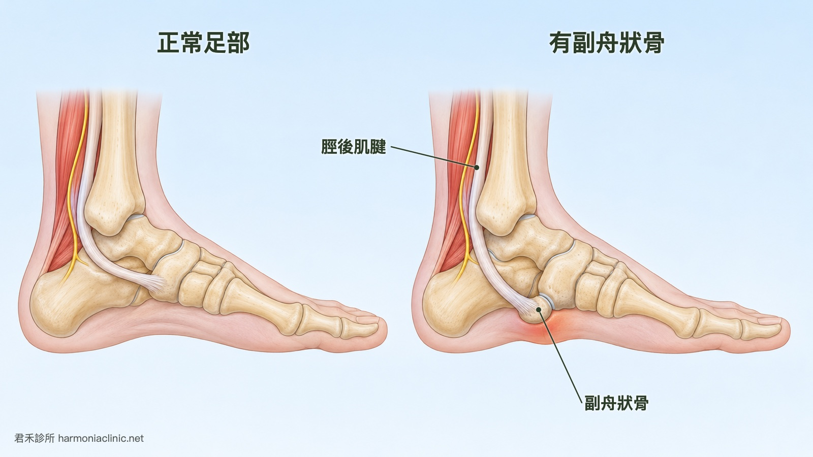

| | |
|---|---|
| **常見症狀** | 腳內側足弓上方凸起 ・ 穿鞋摩擦處紅腫疼痛 ・ 跑跳或久走後加劇 ・ 按壓凸起處會痛 |
| **要儘快就醫** | 外傷後無法踩地或變形 ・ 紅腫發熱合併發燒 ・ 糖尿病患者腳部紅腫或磨破 ・ 突然發冷蒼白合併劇痛 |
| **治療方向** | 換鞋與減壓墊 ・ 調整活動 ・ 鞋墊支撐 ・ 短期固定與用藥 ・ 物理治療 ・ 必要時手術 |

你是否曾經發現腳的內側、足弓上方有一塊硬硬的凸起，平常不太在意，但換了新鞋、開始跑步打球，或是扭到腳之後，那個地方就開始紅腫疼痛，連走路都不舒服呢？這個位置的疼痛，常見的原因之一就是副舟狀骨。很多人第一次聽到，會擔心是不是一定要開刀。今天就跟大家分享副舟狀骨是什麼、為什麼會痛，以及可以怎麼處理。

## 一分鐘重點

副舟狀骨（accessory navicular）是腳內側舟狀骨旁邊多出來的一小塊骨頭，屬於天生的骨骼變異，很多人一輩子都沒有症狀，只是照 X 光時意外發現。最常被誤會的是以為照到副舟狀骨就需要處理，事實上沒有症狀的副舟狀骨通常不需要治療；會痛的，多半和鞋子摩擦壓迫、肌腱反覆拉扯，或扭傷後副舟狀骨和舟狀骨之間的連接處受傷發炎有關。

處理方向以減少壓迫與拉扯為主，保守治療是第一步，包括換鞋與減壓、調整活動量、鞋墊支撐、短期固定與藥物，以及物理治療；經過一段時間保守治療仍反覆疼痛、影響生活的人，才會討論手術。

**有幾種情況不要等。** 扭傷或跌倒後腳無法踩地、明顯變形，要儘快就醫排除骨折。腳內側紅腫發熱合併發燒，可能是感染，要立刻就醫。糖尿病患者的腳出現新的紅腫發熱，或凸起處磨破、持續滲液（流湯）、變黑，應儘快就醫。腳突然發冷、膚色變得蒼白或發紫，合併劇痛、麻木或無力，要立刻到急診。

## 一、副舟狀骨是什麼？為什麼會多一塊骨頭？

首先帶大家了解足部的構造。舟狀骨位在腳的內側、足弓最高點附近，因為形狀像一艘小船而得名，是撐起內側足弓的重要骨頭。小腿深層有一條脛後肌腱（posterior tibial tendon），沿著內踝後方往下走，主要附著在舟狀骨的內側，協助支撐內側足弓，走路和踮腳時都會用到它。

副舟狀骨是發育過程中形成的一塊額外骨頭，位置在舟狀骨內側、脛後肌腱的附著處，型態因人而異，可能兩腳都有。大致可以分成三型：

- **第一型。** 小而圓，包在肌腱裡面，和舟狀骨沒有相連，一般比較少引起症狀。
- **第二型。** 體積較大，和舟狀骨之間以一層纖維軟骨相連，這個連接處容易因拉扯或外傷受傷，是較常引起疼痛的一型。
- **第三型。** 已經和舟狀骨長在一起，讓舟狀骨內側特別凸出，容易被鞋子摩擦。

*左：正常足部，脛後肌腱附著在舟狀骨內側。右：有副舟狀骨時，舟狀骨內側多出一小塊骨頭，凸起處容易被鞋子摩擦，肌腱的拉力也集中在連接處。AI 生成之概念示意圖，非實際影像。*

簡單來說，副舟狀骨是天生的構造，會不會痛和它的型態以及受力有關。

## 二、副舟狀骨為什麼會痛？哪些人比較容易痛？

疼痛大致有兩個來源。第一是外在的壓迫，凸起的骨頭剛好位在鞋子內側的邊緣，鞋子太窄、太硬，或是穿溜冰鞋、靴子這類包覆較緊的鞋子時，反覆摩擦讓底下的軟組織發炎，進而引起疼痛。第二是內在的拉扯，脛後肌腱每走一步都在拉它附著的地方，對第二型來說，拉力會集中在骨頭之間的連接處，跑跳增加或扭傷之後，連接處可能出現細微的損傷與發炎。

比較容易出現症狀的，包括青春期前後運動量大的孩子、運動量突然增加的人、扭傷過腳的人，以及需要長時間穿較緊較硬鞋子的人。

## 三、副舟狀骨有哪些症狀？

典型的位置在腳的內側、內踝的前下方，摸得到一個凸起，按壓會痛。常見的不適包括：

- 凸起處紅腫，穿鞋摩擦時疼痛
- 走久了、跑跳之後疼痛加劇，休息後減輕
- 足弓內側痠痛，有時延伸到內踝後方
- 孩子可能走路一跛一跛，或運動時不願意用那隻腳出力

症狀常是一陣一陣的，很容易被當成單純的磨腳而忽略。

## 四、副舟狀骨和扁平足有關係嗎？

兩者常被放在一起討論，因為脛後肌腱是撐起足弓的主要肌腱之一，有一種看法認為，副舟狀骨讓肌腱的附著位置改變，可能影響肌腱支撐足弓的效率。不過兩者是否真的有因果關係，目前看法並不一致，有扁平足的人不一定有副舟狀骨，有副舟狀骨的人也有很多足弓正常。

需要特別留意的是，成年人原本正常的足弓在一段時間內慢慢塌陷，合併內踝後方疼痛腫脹、單腳踮腳越來越困難，這可能是脛後肌腱功能不全，需要儘早評估。

## 五、哪些狀況要儘快就醫？

多數副舟狀骨引起的疼痛並不危險，但下面這幾種要儘快就醫：

- **扭傷或跌倒後，腳無法踩地、明顯腫脹變形。** 需要排除骨折或韌帶嚴重受傷。
- **腳內側紅腫發熱，合併發燒。** 可能是感染，要立刻就醫。
- **糖尿病患者的腳出現新的紅腫發熱，或凸起處磨破、持續滲液、變黑。** 腳部感覺可能變差，傷口不容易察覺也不容易癒合。
- **腳突然發冷、膚色變得蒼白或發紫，合併劇痛、麻木或無力。** 可能和血管或神經有關，要立刻到急診。
- **休息時也持續疼痛、夜裡痛醒。** 需要排除疲勞性骨折、感染或腫瘤等問題。

## 六、腳內側痛，一定是副舟狀骨嗎？

不一定，就算照到了副舟狀骨，也不代表疼痛一定是它造成的。位置相近、需要一併考慮的還有：

- **舟狀骨疲勞性骨折或急性骨折。** 疲勞性骨折常見於跑跳量大的運動員，X 光有時看不出來。
- **脛後肌腱發炎或功能不全。** 痛沿著內踝後方往下，可能合併足弓逐漸塌陷。
- **跗骨隧道症候群。** 內踝後方的神經受到壓迫，常合併腳底麻、刺痛。

## 七、需要做哪些檢查？

評估從病史與理學檢查開始，醫師會觸診凸起處、觀察站立時的足弓，並可能請你單腳踮腳尖，評估足部功能。影像檢查用來確認型態並排除其他原因：

- **X 光**：確認有沒有副舟狀骨、屬於哪一型，常會加照特定角度
- **超音波**：看肌腱與周邊軟組織有沒有發炎，也能用來導引注射
- **磁振造影（MRI）**：看連接處與骨頭內部有沒有水腫，症狀不典型或懷疑疲勞性骨折時考慮

不一定每個人都要照 MRI，要安排哪一種檢查，由醫師門診評估後說明。

## 八、副舟狀骨要怎麼治療？

治療的目標是減少壓迫與拉扯，讓發炎的地方有機會恢復。保守治療是第一步：

- **換鞋與減壓。** 選擇內側較寬、鞋面較軟的鞋子，必要時用中間挖空的減壓墊，減少凸起處受到的壓迫。
- **調整活動量。** 疼痛明顯時先減少跑跳，改做游泳、騎腳踏車這類負擔較小的活動，再逐步回到原本的運動。
- **冰敷與口服藥物。** 消炎止痛藥可以作為短期控制症狀的選項，使用前應先問過醫師，特別是有胃病、腎臟病或正在吃抗凝血藥的人。
- **鞋墊與足弓支撐。** 可能幫助減輕脛後肌腱的負擔，適合什麼樣的鞋墊應由醫師評估。
- **短期固定。** 疼痛較嚴重時，可能短期使用護具或行走靴，讓發炎的地方休息。
- **物理治療。** 疼痛緩解後，透過伸展與肌力訓練幫助足部恢復穩定。
- **注射治療。** 類固醇注射一般很少用於副舟狀骨，靠近肌腱注射也有影響肌腱強度的疑慮；其他注射方式針對副舟狀骨的研究仍然有限，是否適合由醫師門診評估後說明。

這些方式可以幫助減輕疼痛與發炎，但副舟狀骨本身一般不會消失，症狀改善後仍要留意鞋子與活動量。整體的治療思路可以參考[骨骼肌肉疼痛，治療的四個階梯](/20260920-pain-four-steps/)。

## 九、在家可以怎麼做？

疼痛緩解之後，可以在不痛的範圍內做下面幾種運動，開始前建議先和醫師或物理治療師確認：

- **小腿伸展。** 面對牆壁站成弓箭步，後腳伸直、腳跟貼地，身體慢慢往前，感覺小腿後側拉緊時停留一下。
- **毛巾抓取。** 坐著用腳趾把地上的毛巾慢慢抓向自己，訓練足部的小肌肉。
- **踮腳尖。** 扶著椅背，雙腳慢慢踮起再放下，不痛之後再逐步改成單腳。

有一點痠或拉緊的感覺是可以接受的，但如果凸起處疼痛加劇、隔天腫得更明顯，應先停止，再詢問醫師或物理治療師。新鞋建議先在家裡穿一段時間，確認不會壓到凸起處；也要避免反覆按壓或自行用力推拿凸起處，會痛就應停止。

## 十、什麼時候該考慮手術？

- **保守治療持續一段時間**，疼痛仍然反覆發作，影響走路或運動
- **凸起處持續被壓迫**，換鞋與減壓都無法改善

常見的手術選項之一是把副舟狀骨切除，並視情況重新固定脛後肌腱。手術可能有感染、神經受傷、肌腱力量減弱或持續疼痛等風險，術後需要一段時間的保護與復健，是否需要由醫師門診評估後說明。

## 治療選項與證據對照

| 治療方式 | 目前的證據 |
|---|---|
| 換鞋、減壓墊、調整活動 | 常見的保守處理選項，專門針對副舟狀骨的比較研究有限 |
| 鞋墊與足弓支撐 | 臨床上常使用，針對副舟狀骨的研究有限，適用與否需個別評估 |
| 短期固定（護具、行走靴） | 常用於疼痛較嚴重的急性期，固定時間依症狀調整 |
| 口服消炎止痛藥 | 可作為短期控制症狀的選項，需考量胃腸、腎功能與其他用藥 |
| 物理治療 | 可納入保守處理，直接針對副舟狀骨的研究有限 |
| 類固醇注射 | 一般很少用於副舟狀骨，靠近肌腱注射有影響肌腱強度的疑慮 |
| 其他注射（例如再生注射） | 針對副舟狀骨的研究很少，是否適合由醫師門診評估後說明 |
| 手術 | 用於保守治療後仍反覆疼痛者，現有研究多為回溯性的病例整理，缺少高品質的前瞻性比較，術後需要復健 |

## 門診鑑別重點與常見誤區

- **「照到副舟狀骨就要處理」。** 沒有症狀通常不需要治療，處理的對象是症狀。
- **「腳內側痛就是副舟狀骨」。** 疲勞性骨折、脛後肌腱問題的位置都很接近。
- **「只是磨腳，忍一下就好」。** 反覆發作代表壓迫或拉扯沒有被矯正，發炎時間可能拉長。
- **「足弓塌了都是副舟狀骨造成的」。** 成年人足弓逐漸塌陷合併踮腳困難，要想到脛後肌腱功能不全。

## 常見問題

### 沒有症狀，只是照片子發現有副舟狀骨，需要治療嗎？

通常不需要。沒有症狀時，一般只要留意鞋子是否合腳，出現疼痛再就醫評估即可。

### 孩子有副舟狀骨，腳痛還可以繼續運動嗎？

要看疼痛的程度。疼痛明顯、走路一跛一跛時，建議先減少跑跳並就醫評估；疼痛緩解後，可以在醫師或物理治療師的建議下逐步回到原本的運動。需不需要暫停、暫停多久，因人而異。

### 副舟狀骨長大之後會消失嗎？

副舟狀骨是一塊真正的骨頭，一般不會自己消失。有些人的症狀會在骨骼發育成熟、活動量調整之後減輕，但也有人到成年之後，才因為外傷或運動量增加開始疼痛。

## 看診時請主動告訴醫師

- **症狀**：什麼時候開始、痛在哪裡、哪些動作或鞋子會讓它更痛
- **外傷與運動**：最近有沒有扭傷，運動量有沒有增加
- **慢性病**：有沒有糖尿病、痛風或類風濕性關節炎
- **用過的藥與治療**：包括止痛藥、抗凝血藥、鞋墊、打過的針與做過的復健

如果大家腳內側的凸起處會痛，並不代表一定是副舟狀骨，即使照到了，也要確認疼痛真的和它有關，再決定處理的方向。副舟狀骨不必緊張，有症狀再評估。

本篇為衛教資訊，不能取代醫師的診斷與治療建議。個別狀況請於門診評估。

各項治療的費用與適應症，請於門診由醫師說明。
